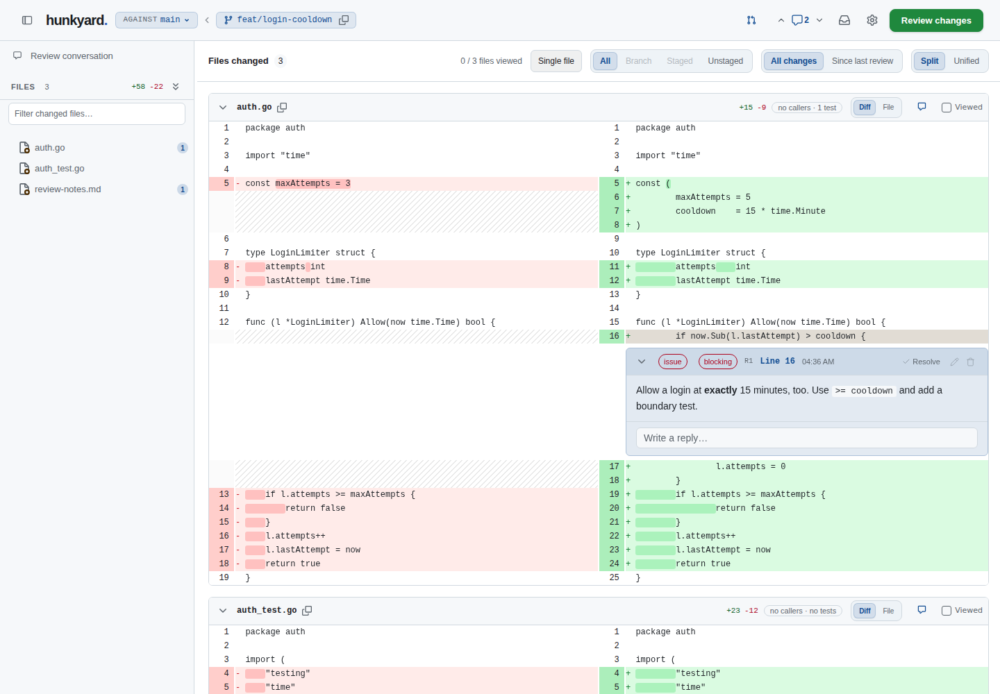
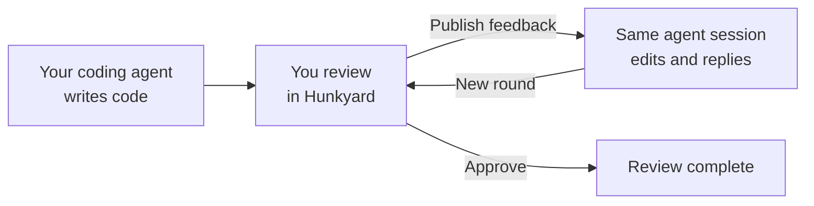
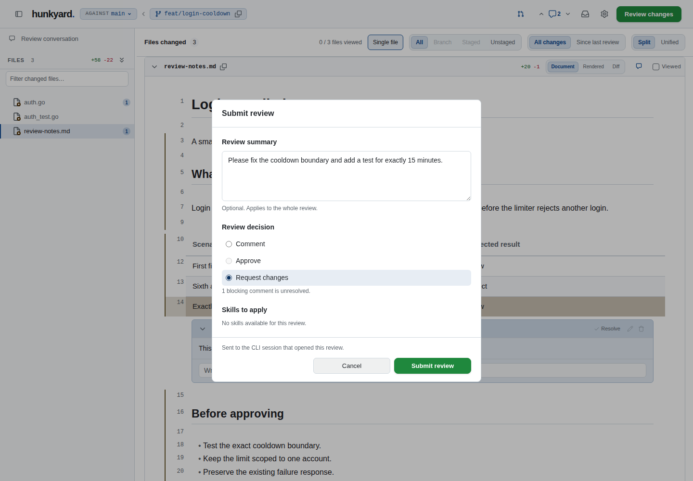
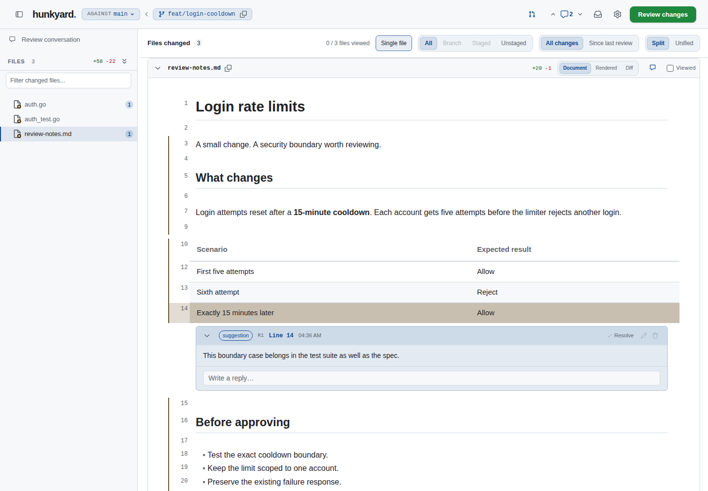

<div align="center">

# Hunkyard

**Your agent writes code. You get the review.**

A local browser review UI for Codex CLI and Claude CLI. Read the diff, comment on the lines that matter, and send feedback back to the same agent session.

[Quick start](#quick-start) · [How it works](#how-it-works) · [What you can review](#what-you-can-review) · [Full guide](docs/guide.md)

</div>



*A review of a login limiter: the code handles “after 15 minutes,” but the reviewer asks for “exactly 15 minutes” too. Example data shown throughout.*

## How it works

Open Hunkyard from your coding agent when you're ready to review. The browser gives you a diff and a place to leave precise feedback. Publishing sends that feedback to the session that opened the review.



1. **Open a review.** Use `$hunkyard` in Codex or `/hunkyard` in Claude. Choose working changes, a commit range, or specific files.
2. **Leave feedback where it belongs.** Comment on a line or range, reply in a thread, and mark issues as blocking. Review plans as rendered Markdown or pin comments to a running app.
3. **Publish your decision.** Choose Comment, Request changes, or Approve. You can add a summary and select skills offered by the launching agent. Unresolved blocking comments and unanswered blocking decisions keep approval disabled.
4. **Review the next round.** The same agent session applies the feedback and replies. Use **Since last review** to focus on its latest edits. Repeat until you're ready to approve.

<details>
<summary>See the submit dialog</summary>



Publishing is an explicit action. Comments are saved as you write; the submit dialog sends your review to the launching CLI session.

</details>

Hunkyard runs as **one Go binary**, with its browser assets embedded. The agent workflow uses your existing CLI session's tools, permissions, and model connection. The standalone binary also works for manual review; automatic feedback processing requires the installed host workflow.

## Quick start

### 1. Install Hunkyard

On **Linux or macOS** (Intel or ARM64):

```sh
curl -fsSL https://raw.githubusercontent.com/BSH2409/hunkyard/main/install.sh | bash
```

The installer checks prerequisites, downloads the latest release, verifies its SHA-256 checksum, and installs it to `~/.local/bin` without sudo. It adds that directory to your Bash or Zsh startup file if needed; open a new terminal or run the printed PATH command to use it immediately.

You need **Bash, Git, curl**, and either **sha256sum** or **shasum**. Go and Node are not required. On native Windows, download a binary from [Releases](https://github.com/BSH2409/hunkyard/releases/latest), or run the installer in WSL.

<details>
<summary>Build from source instead</summary>

With Git and Go 1.26+ installed:

```sh
git clone https://github.com/BSH2409/hunkyard.git
cd hunkyard
mkdir -p "$HOME/.local/bin"
go build -o "$HOME/.local/bin/hunkyard" ./cmd/hunkyard
```

Add `~/.local/bin` to your `PATH`. Node is only needed for frontend development.

</details>

Run `hunkyard` in a repository with changes. It opens the review in your browser at `http://localhost:5000` by default. [Install a specific version or choose another directory →](docs/guide.md#install-a-release)

### 2. Connect your coding agent

Install the workflow for your CLI:

```sh
hunkyard install --global codex    # Codex CLI
hunkyard install --global claude   # Claude CLI
```

Then use **`$hunkyard` in Codex** or **`/hunkyard` in Claude** to start the review loop. You may need a new CLI session after installation. Existing integration files are preserved unless you supply `--force`.

### 3. Pick what to review

Run these from the repository you want to review:

```sh
hunkyard                              # working changes
hunkyard --range HEAD~3..HEAD          # exact commit range
hunkyard --range main...HEAD           # compare from the merge base
hunkyard src/auth.go src/auth_test.go  # selected code changes
hunkyard README.md                    # a Markdown document
hunkyard live http://localhost:3000    # a running local app
hunkyard preview docs/page.html       # a local HTML page
```

Use `--port 0` for a free port or `--no-open` to print the URL without opening a browser. For agent feedback, ask your CLI's Hunkyard workflow to open the scope you want.

> **Running in Docker?** Publish `-p 127.0.0.1:5000:5000` and open the URL on the host. The server binds to `0.0.0.0` by default and its browser API has no network authentication. Outside Docker, `--host 127.0.0.1` restricts listening to this machine. [Docker setup →](integrations/docker/README.md)

## What you can review

| Review | What you see | Try it |
| --- | --- | --- |
| Code changes | Split or unified diffs, inline threads, viewed files, and changes since your last review | `hunkyard` |
| Commit ranges | A fixed comparison or a comparison from the merge base | `hunkyard --range main...HEAD` |
| Plans and Markdown | Rendered documents with comments tied to source lines | `hunkyard plan.md` |
| Local apps and HTML | The page itself, with comments pinned to elements and screenshots for the agent | `hunkyard live http://localhost:3000` |
| Changed images | Before/after, slider, and onion-skin views for PNG, JPEG, GIF, and WebP | Include image changes in a Git review |

### Review the document, too

Read a plan as a document, comment on a table row, and keep the feedback attached to its source lines. Markdown in a Git review can switch between Document and Diff views.



### Bring more context into the diff

- Import coverage, test results, and static-analysis findings with `hunkyard annotate`. Findings appear beside the code; uncovered changed lines get a red edge.
- Check the impact pill for tracked files that mention changed symbols, grouped into callers and tests. These are text matches, not a call graph.
- Order files **By risk** using sensitive paths, change size, test coverage, and open rule findings.
- Let the agent ask you a question with `hunkyard ask`. Your answers return with the next published review.

[Review tools and annotation commands →](docs/guide.md#review-tools)

## Your feedback can become a preference

“Fix this boundary case” belongs to this change. “Always test exact time boundaries” can be a reusable coding preference.

Hunkyard's preference workflow classifies human feedback, keeps uncertain rules pending, and makes relevant active rules available to later agent sessions. Agent replies and imported tool findings are excluded from preference evidence. The Preferences tab lets you inspect the rules, their evidence, and what each session received.

Preference learning is supported on macOS and Linux, including WSL. Reviews also work on native Windows; preference learning there is unsupported.

[Set up preferences, hooks, and team packs →](docs/guide.md#go-backed-coding-preferences)

## Local review, familiar workflow

Reviews work with local files and Git objects. Hunkyard requires no GitHub account, push, or remote fetch. Review state stays under `~/.hunkyard`; browser libraries and fonts ship in the binary. Hunkyard performs no telemetry or update checks.

Your coding agent still uses its model provider as usual. Optional automatic preference maintenance runs the model CLI you configure. Pages opened in live or preview mode can load their own external resources; `HUNKYARD_BLOCK_EXTERNAL=1` restricts them to local resources.

[Local-only behavior and storage details →](docs/guide.md#local-only-behavior)

## Keep going

| Read about | Where |
| --- | --- |
| Review rounds, idle pause, inbox, and insights | [Full guide](docs/guide.md) |
| Codex and Claude setup | [Integrations](integrations/README.md) |
| Live app review and HTML preview | [Live mode](docs/live-mode.md) |
| How the host receives and processes feedback | [Local review protocol](integrations/shared/review-workflow.md) |
| Building, testing, and contributing | [Development](docs/guide.md#development) · [Contributing](CONTRIBUTING.md) |

[MIT license](LICENSE)
